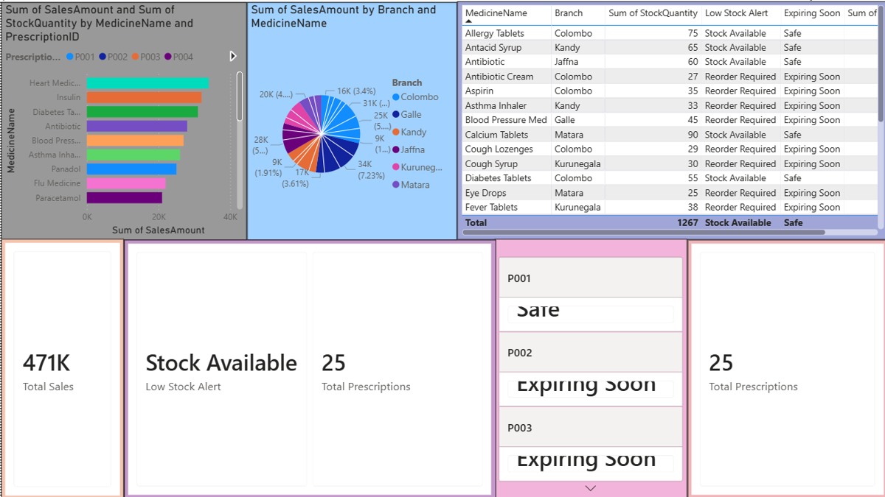
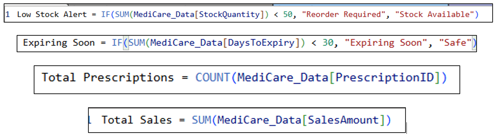

# 💊 MediCare Pharmacy BI Dashboard

A **Power BI** dashboard prototype for **MediCare Pharmacy Chain (PVT) Ltd** that centralises sales, stock, expiry, and prescription data so managers can spot low-stock and expiring medicines early.

## 📌 Project Overview

Completed for **Unit 17: Business Process Support** (Pearson BTEC HND in Computing). In the scenario, MediCare's branches track sales, stock, prescriptions, and expiry dates in separate Excel files, causing delayed restocking, missed expiry dates, and no real-time view for management. I acted as a Junior Business Process Support Analyst and built a BI solution to address this.

## 🎯 Business Problems Addressed

- Delays in stock replenishment
- Difficulty tracking medicine expiry dates
- Limited visibility of sales by branch and medicine
- No central view of prescription activity

## 📊 Dataset

A sample dataset of **25 records** across **6 branches** (Colombo, Galle, Kandy, Jaffna, Kurunegala, Matara), created for this assignment. Fields: `MedicineName`, `Branch`, `SalesAmount`, `StockQuantity`, `DaysToExpiry`, `PrescriptionID`.

File: [`data/MediCare_PowerBI_Data.xlsx`](data/MediCare_PowerBI_Data.xlsx)

**Data quality fix:** one record had an invalid, non-numeric expiry value, which was corrected in Power Query so expiry alerts are accurate.

## 🧩 Dashboard Components

- **KPI cards:** Total Sales and Total Prescriptions
- **Sales by medicine:** top-selling medicines
- **Sales by branch:** branch contribution to revenue
- **Stock and expiry table:** per-medicine stock quantity with **Reorder Required / Stock Available** and **Expiring Soon / Safe** flags

## ⚙️ DAX Measures

| Measure | Logic |
|---|---|
| Total Sales | Sum of `SalesAmount` |
| Total Prescriptions | Count of `PrescriptionID` |
| Low Stock Alert | "Reorder Required" when stock is below 50 units |
| Expiring Soon | "Expiring Soon" when days to expiry is below 30 |

Full formulas

## 📈 Key Findings

- **Total sales: 470,500** across 25 medicines.
- **Colombo leads** with 136,000 (28.9%), followed by Galle (110,000, 23.4%). Kandy, Jaffna, Kurunegala and Matara make up the rest.
- **Top sellers:** Heart Medicine (34,000), Insulin (32,000), Diabetes Tablets (31,000), Antibiotic (28,000), and Blood Pressure Medicine (27,000).
- **13 of 25 medicines (52%) are below the 50-unit reorder threshold.**
- **12 medicines are within 30 days of expiry.**
- **Critical overlap:** three of the five top sellers (Heart Medicine, Insulin and Blood Pressure Medicine) are both low in stock and close to expiry, so they need priority attention.

## 💡 Recommendations

1. Automate low-stock alerts so staff reorder before shortages occur
2. Prioritise restocking and rotation for high-selling, near-expiry medicines
3. Review stock allocation between higher- and lower-performing branches
4. Use expiry flags to remove or discount medicines before they expire
5. Centralise branch data in one database instead of separate spreadsheets

## 🚧 Limitations and Next Steps

- This is a **prototype built on a small sample dataset**, not live pharmacy data.
- The data has no dates, so **sales trends over time** can't be analysed yet.
- Next steps: connect to a database for live data, add a date field for trend analysis, add a branch slicer, and forecast demand to improve reorder levels.

## 📄 Documentation

- [Project report extract: design and implementation (docx)](medicare-bi-report-extract.docx)

## 📂 Repository Contents

| File | Description |
|---|---|
| `MediCare_Dashboard.pbix` | Power BI file (open with Power BI Desktop) |
| `data/` | Sample dataset (Excel) |
| `images/` | Dashboard screenshots |
| `docs/` | Report extract |

## 👤 Author

**Afry Nizam**: BSc Information Technology student, University of West London
[LinkedIn](https://www.linkedin.com/in/afrynizam) · [GitHub](https://github.com/afrynizam07)
